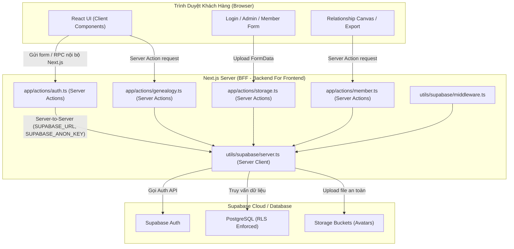

# Thiết Kế Chi Tiết: Bảo Mật Toàn Diện Hệ Thống (BFF & Server Actions Hardening)

- **Ngày tạo:** 2026-10-23
- **Nhánh thực hiện:** `fix/security-hardening`
- **Mục tiêu:** Loại bỏ hoàn toàn việc để lộ Supabase URL, API Key ở client (trình duyệt); chuyển 100% thao tác Auth, Data Fetching, Upload Storage sang Server Actions (BFF Pattern); loại bỏ hardcoded credentials trong scripts; bảo vệ toàn vẹn dữ liệu gia phả.

---

## 1. Kiến Trúc Tổng Quan (BFF Pattern)

### Nguyên tắc cốt lõi:
1. **Zero Client Secrets**: Trình duyệt chỉ giao tiếp với Next.js domain (`giaphadongho.com`). Không có bất kỳ request nào từ trình duyệt gửi trực tiếp tới `*.supabase.co`.
2. **Server-Side Cookie Management**: Đăng nhập, đăng ký, đăng xuất đều được xử lý ở server Next.js qua cookie HTTP-Only an toàn (`@supabase/ssr`).
3. **Defense-in-depth**: Dữ liệu tải về từ server luôn được lọc theo quyền (`familyId`, `treeId`, `is_system_admin`, `canEdit`).

---

## 2. Chi Tiết Các Hạng Mục Thực Hiện

### Hạng mục 1: Xây dựng Server Actions cho Xác thực (`app/actions/auth.ts`)
- **`loginAction(formData)`**:
  - Nhận `email`, `password`.
  - Tạo server supabase client với cookies.
  - Gọi `supabase.auth.signInWithPassword`.
  - Trả về `{ success: true, redirect: "/dashboard" }` hoặc `{ error: string }`.
- **`adminLoginAction(formData)`**:
  - Nhận `email`, `password`, `nextPath`.
  - Gọi `signInWithPassword`.
  - Kiểm tra bảng `profiles` ở server: `role === 'system_admin'` và `is_active === true`.
  - Nếu không thoả mãn, gọi `signOut()` ngay lập tức ở server và trả về lỗi quyền truy cập.
  - Xử lý chuyển hướng `/admin/change-password` nếu `must_change_password` là true.
- **`signUpAction(formData)`**:
  - Nhận `email`, `password`, `confirmPassword`.
  - Kiểm tra mật khẩu khớp và độ dài tối thiểu.
  - Gọi `supabase.auth.signUp`.
  - Tự động đăng nhập nếu có session hoặc trả về thông báo thành công.
- **`signOutAction()`**:
  - Gọi `supabase.auth.signOut()` ở server để huỷ session cookies.
  - Trả về `{ success: true }`.

### Hạng mục 2: Tái cấu trúc các Client Component xác thực
- **`app/login/page.tsx`**:
  - Chuyển `handleSubmit` sang gọi `loginAction` và `signUpAction`.
  - Xoá hoàn toàn `import { createClient } from "@/utils/supabase/client"`.
- **`app/admin/login/page.tsx`**:
  - Chuyển `handleSubmit` sang gọi `adminLoginAction`.
  - Xoá hoàn toàn `import { createClient } from "@/utils/supabase/client"`.
- **`components/LogoutButton.tsx`**:
  - Chuyển `handleLogout` sang gọi `signOutAction`.
  - Xoá hoàn toàn `import { createClient } from "@/utils/supabase/client"`.
- **`components/UserProvider.tsx`**:
  - Loại bỏ đối tượng `supabase` khỏi UserContext, thay thế bằng stub an toàn nếu có component con phụ thuộc, ngăn chặn tạo browser client rò rỉ key.

### Hạng mục 3: Tái cấu trúc Truy vấn Dữ liệu Client & Storage Upload
- **`app/actions/storage.ts`**:
  - Tạo Server Action `uploadAvatarAction(formData)`:
    - Nhận `file: File`, `familyId: string`.
    - Kiểm tra định dạng (chỉ cho phép image/jpeg, image/png, image/webp), dung lượng <= 5MB.
    - Server upload trực tiếp lên bucket `avatars` bằng server Supabase client.
    - Trả về `{ publicUrl: string }` hoặc `{ error: string }`.
  - Tạo Server Action `deleteAvatarAction(filePath: string)`.
- **`components/MemberForm.tsx`**:
  - Thay thế việc upload storage trực tiếp bằng `uploadAvatarAction`.
  - Xoá `import { createClient } from "@/utils/supabase/client"`.
- **`app/actions/genealogy.ts`**:
  - Bổ sung `getCanvasDataAction(familyId, treeId)`: tải danh sách `persons` và `relationships` ở server.
  - Bổ sung `getRelationshipSearchAction(familyId, treeId, query)`: phục vụ tìm kiếm quan hệ.
- **`components/RelationshipCanvasEditor.tsx` & `components/RelationshipManager.tsx`**:
  - Gọi Server Actions thay vì `supabase.from("persons").select(...)`.
  - Xoá `import { createClient } from "@/utils/supabase/client"`.
- **`components/MemberDetailModal.tsx`**:
  - Chuyển việc fetch `persons` và `person_details_private` sang Server Action `getMemberDetailAction`.
- **`components/DataImportExport.tsx`**:
  - Chuyển việc fetch danh sách thành viên sang Server Action.

### Hạng mục 4: Chuyển đổi Biến Môi Trường sang Server-Only
- Cập nhật `utils/supabase/server.ts` và `utils/supabase/middleware.ts`:
  - Ưu tiên đọc biến server: `process.env.SUPABASE_URL || process.env.NEXT_PUBLIC_SUPABASE_URL`.
  - Ưu tiên đọc key server: `process.env.SUPABASE_ANON_KEY || process.env.NEXT_PUBLIC_SUPABASE_PUBLISHABLE_DEFAULT_KEY`.
- Cập nhật `.env.local` và `.env.example`:
  - Thêm cấu hình `SUPABASE_URL` và `SUPABASE_ANON_KEY`.
- Cập nhật `utils/supabase/client.ts`:
  - Trả về an toàn hoặc proxy, không đọc hoặc xuất biến bí mật ra trình duyệt.

### Hạng mục 5: Dọn dẹp Hardcoded Credentials trong Thư mục `scripts/`
- Cập nhật các file:
  - `scripts/backup-full-database.mjs`
  - `scripts/restore-from-backup.mjs`
  - `scripts/restore-diepdung-and-blogs.mjs`
  - `scripts/wipe-accessible-data.mjs`
- Xoá bỏ hoàn toàn các chuỗi fallback chứa URL thực `https://srsckyplvrwuweqbcegk.supabase.co` và key `sb_publishable_...`.
- Bắt buộc kiểm tra biến môi trường: nếu thiếu sẽ in thông báo hướng dẫn và thoát an toàn với mã lỗi 1.

### Hạng mục 6: Kiểm thử Tự động & Xác thực (Regression Tests & Build)
- Bổ sung các ca kiểm thử trong `tests/security-hardening.test.mjs`:
  - Kiểm tra không có client component nào (`use client`) gọi trực tiếp `@/utils/supabase/client`.
  - Kiểm tra các script trong `scripts/` không chứa chuỗi fallback credential.
  - Kiểm tra Server Actions `loginAction`, `adminLoginAction`, `signUpAction`, `signOutAction`.
- Chạy `npm.cmd test` (toàn bộ test suites phải PASS 100%).
- Chạy `npm.cmd run build` (Next.js build thành công, kiểm tra bundle JS không chứa Supabase URL / anon key).

---

## 3. Tiêu Chí Hoàn Thành (Definition of Done)
1. 100% các thành phần Client không import và không gọi trực tiếp Supabase client.
2. Không có URL hay API key nào của Supabase bị inlined vào file JS gửi về client.
3. Toàn bộ tính năng gia phả (Xem cây, biên tập quan hệ, modal thành viên, upload avatar, đăng nhập, phân quyền gia tộc) hoạt động mượt mà, chính xác.
4. Toàn bộ bộ test tự động (`npm.cmd test`) vượt qua thành công.
5. `npm.cmd run build` thành công không có lỗi.
