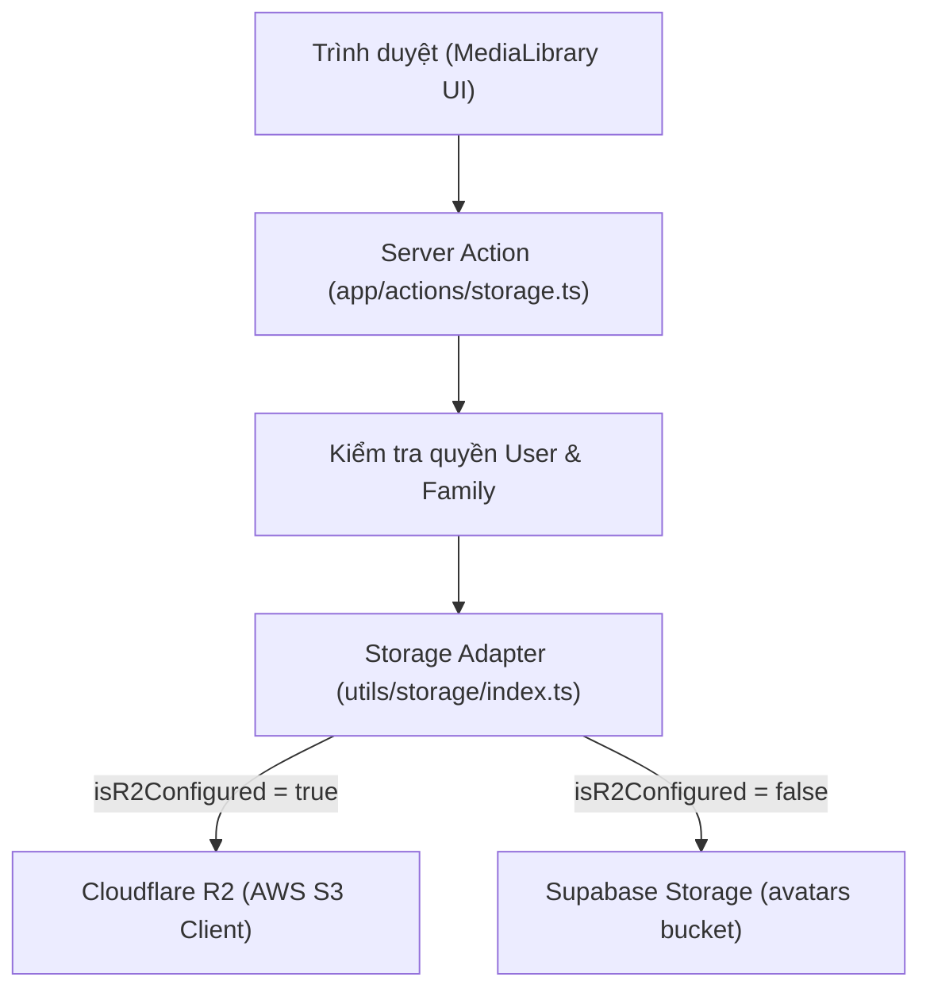

# Thiết Kế Kỹ Thuật: Thư Viện Ảnh (Media Library) Cho Dòng Họ & Quản Trị Hệ Thống

**Ngày:** 2026-10-28  
**Trạng thái:** Chờ phê duyệt  
**Mục tiêu:** Cung cấp giao diện và dịch vụ quản lý kho ảnh trực quan (Media Library) được lưu trữ trên Cloudflare R2 (hoặc Supabase Storage fallback), hỗ trợ xem ảnh dạng lưới, phóng to xem trước, sao chép URL công khai, tải ảnh mới và xóa ảnh không còn sử dụng.

---

## 1. Yêu cầu nghiệp vụ & Phân quyền

1. **Phân quyền trong dòng họ (`/dashboard/[familySlug]/media`):**
   - Người phụ trách dòng họ (`family_admin`) hoặc Quản trị viên hệ thống (`system_admin`) có quyền xem, tải lên và xóa ảnh thuộc phạm vi thư mục của dòng họ đó.
   - Thành viên thông thường (`member`) có quyền xem và sao chép URL ảnh tư liệu của dòng họ.
2. **Phân quyền trong hệ thống quản trị chung (`/admin/media`):**
   - Chỉ tài khoản Quản trị tối cao (`system_admin`) mới có quyền truy cập để xem toàn bộ kho ảnh của tất cả các dòng họ trên hệ thống và dọn dẹp ảnh rác.
3. **Bảo mật và an toàn dữ liệu:**
   - Khi xóa ảnh, hệ thống bắt buộc kiểm tra quyền sở hữu của user đối với thư mục ảnh đó.
   - Thao tác xóa file vĩnh viễn trên Cloudflare R2 phải có hộp thoại xác nhận.

---

## 2. Kiến trúc & Thiết kế kỹ thuật



### 2.1. Nâng cấp Storage Adapter (`utils/storage/index.ts`)
Bổ sung interface và hàm liệt kê danh sách tệp tin:
```typescript
export interface StorageFileItem {
  key: string;            // Ví dụ: "f-123/avatar-17931.webp"
  name: string;           // Tên file hiển thị
  url: string;            // URL công khai truy cập ảnh
  size: number;           // Kích thước tệp (bytes)
  lastModified?: string;  // Thời gian cập nhật ISO string
  folder: string;         // Tên thư mục chứa (ví dụ: f-123)
}

export interface ListStorageOptions {
  folder?: string;
  maxKeys?: number;
  continuationToken?: string;
  bucketFallback?: string;
}

export interface ListStorageResult {
  success: boolean;
  files: StorageFileItem[];
  nextContinuationToken?: string;
  isTruncated: boolean;
  error?: string;
}

export async function listStorageFiles(options?: ListStorageOptions): Promise<ListStorageResult>;
```
- **Xử lý với Cloudflare R2:** Dùng `ListObjectsV2Command` từ `@aws-sdk/client-s3` với `Bucket: bucketName`, `Prefix: cleanFolder`, `ContinuationToken`.
- **Xử lý với Supabase Storage Fallback:** Dùng `supabase.storage.from(bucket).list(cleanFolder)`.

### 2.2. Server Actions (`app/actions/storage.ts`)
1. **`listMediaAction(familySlug?: string, continuationToken?: string)`**:
   - Xác thực người dùng thông qua session cookies.
   - Nếu có `familySlug`: Kiểm tra quyền truy cập vào dòng họ, xác định `cleanFamilyId = family.id` và lấy danh sách file thuộc tiền tố `cleanFamilyId/`.
   - Nếu không có `familySlug` (truy cập từ `/admin/media`): Bắt buộc người dùng phải là `system_admin`, trả về danh sách ảnh toàn hệ thống.
2. **`deleteMediaAction(filePath: string, familySlug?: string)`**:
   - Kiểm tra người dùng có quyền xóa file tương ứng.
   - Gọi hàm `deleteStorageImage(filePath)`.

### 2.3. Thành phần giao diện dùng chung (`components/MediaLibrary.tsx`)
- **Hiển thị:** Lưới (Responsive Grid) 2 cột trên điện thoại, 4-6 cột trên máy tính.
- **Thẻ ảnh (Image Card):**
  - Khung xem trước ảnh định dạng WebP/JPG với aspect-ratio vuông hoặc 4:3.
  - Nhãn hiển thị kích thước (ví dụ: `142 KB`) và ngày tải lên.
- **Thanh công cụ (Toolbar):**
  - Thống kê tổng số lượng ảnh hiển thị.
  - Nút **Tải ảnh mới**: Cho phép chọn ảnh từ máy, nén WebP và tải thẳng lên R2.
- **Hộp thoại xem phóng to (Lightbox Modal):**
  - Mở ảnh to, hiển thị đường dẫn chi tiết, nút **Sao chép URL** (kèm thông báo "Đã sao chép!").
  - Nút **Xóa ảnh** màu đỏ với cảnh báo xác nhận.

### 2.4. Tích hợp các trang & Điều hướng
1. **Trang Dòng họ (`app/dashboard/[familySlug]/media/page.tsx`):**
   - Nạp ngữ cảnh dòng họ qua `getFamilyContextBySlug`.
   - Nhúng `MediaLibrary` với phạm vi `familySlug={familySlug}`.
2. **Trang Quản trị hệ thống (`app/admin/media/page.tsx`):**
   - Yêu cầu `getIsSystemAdmin()`.
   - Nhúng `MediaLibrary` toàn quyền hệ thống.
3. **Cập nhật Điều hướng:**
   - Bổ sung `media: { label: "Thư viện ảnh", icon: Image }` vào [`components/WorkspaceBreadcrumb.tsx`](file:///e:/Work/giaphadongho/components/WorkspaceBreadcrumb.tsx).
   - Thêm thẻ tính năng **Thư viện ảnh** vào danh sách tính năng tại [`app/dashboard/[familySlug]/page.tsx`](file:///e:/Work/giaphadongho/app/dashboard/[familySlug]/page.tsx).

---

## 3. Kế hoạch kiểm thử (Testing Strategy)

1. **Bộ kiểm thử `tests/media-library.test.ts`:**
   - Test `listStorageFiles` khi R2 được cấu hình (gọi S3 `ListObjectsV2Command`) và trả về danh sách chuẩn hóa `StorageFileItem`.
   - Test `listStorageFiles` fallback về Supabase storage khi R2 không cấu hình.
   - Test tính hợp lệ của phân quyền Server Actions `listMediaAction` và `deleteMediaAction`.
   - Test component và route tích hợp trên `WorkspaceBreadcrumb` và các trang.
2. **Kiểm thử hồi quy:** Chạy toàn bộ 83 bài test hiện có đảm bảo 100% vượt qua.
