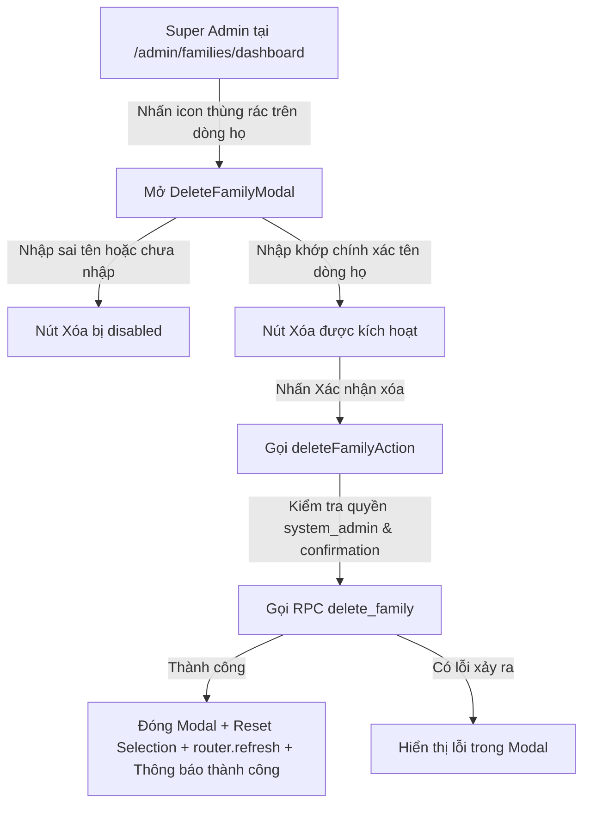

# Thiết Kế Kỹ Thuật: Chức Năng Xóa Dòng Họ Cho Super Admin

- **Ngày tạo:** 2026-11-21
- **Trạng thái:** Đã duyệt (Approved)
- **Phạm vi:** Trang Dashboard Dòng Họ (`/admin/families/dashboard`), Modal xác nhận an toàn (`DeleteFamilyModal`), Server Action (`deleteFamilyAction`), Stored Procedure (`delete_family`).

---

## 1. Mục Tiêu & Yêu Cầu

### 1.1 Mục tiêu
Cung cấp khả năng xóa dòng họ trực quan, an toàn và thuận tiện cho Super Admin (Quản trị viên hệ thống) ngay trên bảng danh sách dòng họ tại `/admin/families/dashboard`, ngăn ngừa việc vô tình xóa nhầm dữ liệu gia phả bằng cơ chế xác nhận đối chiếu tên dòng họ trong Modal popup chuyên biệt.

### 1.2 Yêu cầu chức năng
- **Nút xóa trên từng dòng:** Tại cột "Thao tác" trong bảng danh sách dòng họ, bổ sung nút icon thùng rác (`Trash2`) với màu sắc cảnh báo (hover đỏ). Nút có `title="Xóa dòng họ"`.
- **Modal xác nhận xóa (`DeleteFamilyModal`):**
  - Mở lên khi Super Admin nhấn nút xóa ở bảng hoặc nhấn nút xóa trong Vùng nguy hiểm ở thanh chi tiết (drawer).
  - Hiển thị tên dòng họ, slug, số lượng thành viên hiện tại và cảnh báo rõ ràng rằng hành động này là vĩnh viễn và không thể phục hồi.
  - Cung cấp ô nhập tên dòng họ để xác nhận. Nút "Xóa dòng họ" bị vô hiệu hóa (`disabled`) cho tới khi người dùng nhập chính xác chuỗi tên dòng họ.
  - Hỗ trợ phím Escape hoặc nút "Hủy" để đóng modal khi không thực hiện thao tác.
  - Khi đang gửi yêu cầu xóa: Hiển thị spinner xoay (`Loader2`), vô hiệu hóa nút hủy và nút xác nhận để tránh gọi lặp lại.
- **Xử lý sau khi xóa:**
  - Nếu thành công: Đóng modal, hiển thị thông báo thành công (Notice banner xanh), cập nhật giao diện (`router.refresh()`).
  - Nếu dòng họ vừa xóa đang được chọn mở thanh chi tiết (`selectedFamilyId`), tự động chọn dòng họ hợp lệ tiếp theo hoặc bỏ chọn nếu danh sách trống.
  - Nếu thất bại: Hiển thị thông báo lỗi cụ thể ngay bên trong modal hoặc trên notice banner.

### 1.3 Ràng buộc bảo mật & Dữ liệu
- **Chỉ Super Admin (`system_admin`):** Hàm Server Action `deleteFamilyAction` và Stored Procedure `delete_family` đã có sẵn cơ chế chặn: chỉ tài khoản có vai trò `system_admin` mới được phép thực thi.
- **Xóa Cascade:** Stored Procedure `delete_family` chịu trách nhiệm dọn dẹp toàn bộ dữ liệu phụ thuộc (notifications, change_requests, invitations, documents, custom_events, relationships, persons, memorial letters, blog posts, family_trees, family_memberships, audit_logs) trước khi xóa dòng dữ liệu trong bảng `families`.

---

## 2. Kiến Trúc & Luồng Dữ Liệu

### 2.1 Sơ đồ luồng (Flowchart)



### 2.2 Thành phần giao diện & Tệp liên quan

1. **`components/DeleteFamilyModal.tsx` (Mới hoặc component con):**
   - Quản lý trạng thái mở/đóng, ô nhập xác nhận, trạng thái loading và hiển thị thông tin cảnh báo dòng họ cần xóa.
2. **`components/AdminFamilyDashboard.tsx`:**
   - Bổ sung nút Thùng rác vào cột "Thao tác" cho từng hàng (`<tr>`) trong `paginatedFamilies.map`.
   - Kết nối sự kiện mở Modal xóa với `familyToDelete`.
   - Đồng bộ phần Vùng nguy hiểm ở thanh chi tiết (drawer) để kích hoạt chung Modal này thay vì form inline chật chội.
   - Cập nhật logic reset `selectedFamilyId` khi dòng họ đang chọn bị xóa.
3. **`app/actions/family.ts`:**
   - Tái sử dụng Server Action `deleteFamilyAction` hiện có, đảm bảo trả về `{ success: true }` hoặc `{ error: string }` chuẩn xác.

---

## 3. Chi Tiết Thực Hiện

### 3.1 Giao diện `DeleteFamilyModal`
- Dialog backdrop mờ (`fixed inset-0 z-50 bg-stone-900/60 backdrop-blur-sm`).
- Container màu trắng bo tròn (`rounded-3xl bg-white p-6 sm:p-8 max-w-lg shadow-2xl`).
- Header cảnh báo với icon `AlertTriangle` màu đỏ trong vòng tròn đỏ nhạt.
- Nội dung:
  - Tên dòng họ in đậm: `{family.name}` (`/{family.slug}`).
  - Thống kê: `{family.person_count} thành viên / hồ sơ`.
  - Hướng dẫn: "Vui lòng nhập chính xác **`{family.name}`** vào ô bên dưới để xác nhận xóa."
  - Input field viền đỏ khi focus, placeholder là tên dòng họ.
  - Nhóm nút bấm: Nút "Hủy bỏ" (nền xám nhạt) và nút "Xác nhận xóa vĩnh viễn" (nền đỏ `bg-red-600 hover:bg-red-700`, kèm `Loader2` khi đang submit).

### 3.2 Tích hợp vào `AdminFamilyDashboard.tsx`
- State mới:
  ```typescript
  const [familyToDelete, setFamilyToDelete] = useState<AdminFamilyRow | null>(null);
  ```
- Nút bấm trên từng dòng:
  ```tsx
  <button
    type="button"
    onClick={(event) => {
      event.stopPropagation();
      setFamilyToDelete(family);
    }}
    className="inline-flex items-center justify-center rounded-full border border-stone-200 bg-white p-2 text-stone-700 shadow-sm transition hover:border-red-300 hover:bg-red-50 hover:text-red-600"
    title={`Xóa ${family.name}`}
  >
    <Trash2 className="size-4" />
  </button>
  ```
- Xử lý khi xóa hoàn tất:
  ```typescript
  if (selectedFamilyId === deletedFamilyId) {
    const remaining = families.filter(f => f.id !== deletedFamilyId);
    setSelectedFamilyId(remaining[0]?.id || "");
  }
  ```

---

## 4. Xử Lý Các Trường Hợp Biên (Edge Cases)

1. **Xóa dòng họ đang được chọn trên drawer:**
   - Hệ thống tự động chuyển `selectedFamilyId` sang dòng họ đầu tiên còn lại hoặc chuỗi rỗng nếu danh sách không còn dòng họ nào.
2. **Dòng họ có tên chứa ký tự đặc biệt hoặc khoảng trắng:**
   - Việc so khớp dùng chuỗi chính xác (`confirmation.trim() === targetFamily.name.trim()`) để đảm bảo người dùng có ý thức rõ ràng về dòng họ đang xóa.
3. **Thao tác nhấp kép hoặc mạng chậm:**
   - Nút bấm chuyển sang `disabled` ngay khi click xác nhận và hiển thị `Loader2`, backdrop chặn click ra ngoài trong khi đang thực thi.
4. **Lỗi RLS / Database:**
   - Nếu RPC báo lỗi (ví dụ còn ràng buộc khóa ngoại chưa dọn), bắt lỗi và hiển thị rõ ràng trên UI, không làm treo ứng dụng.

---

## 5. Kế Hoạch Kiểm Thử (Verification Plan)

### 5.1 Kiểm thử tự động (Unit / Regression Tests)
- Chạy kiểm tra TypeScript (`npx tsc --noEmit` hoặc test suite hiện có) để đảm bảo không lỗi kiểu dữ liệu.
- Viết / cập nhật test kiểm thử render của nút xóa và modal xác nhận.

### 5.2 Kiểm thử thủ công (Manual Checks)
1. Đăng nhập với tài khoản Super Admin, truy cập `/admin/families/dashboard`.
2. Quan sát cột "Thao tác" của bảng: xác nhận có nút thùng rác màu đỏ.
3. Bấm nút thùng rác: Modal popup hiện lên với đúng thông tin dòng họ được chọn.
4. Thử nhập sai tên dòng họ: Nút "Xác nhận xóa" vẫn bị disabled.
5. Thử bấm "Hủy" hoặc nhấn phím ESC: Modal đóng lại, không có thay đổi nào.
6. Thử nhập đúng tên dòng họ: Nút "Xác nhận xóa" sáng lên, bấm xóa -> kiểm tra spinner, thông báo thành công và dòng họ biến mất khỏi danh sách.
