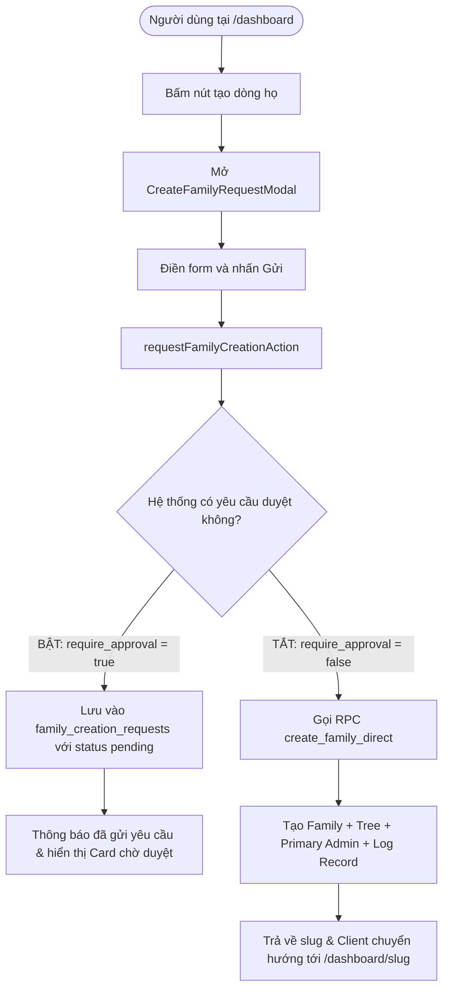

# Thiết Kế Kỹ Thuật: Chức Năng Bật/Tắt Duyệt Dòng Họ Khi Thành Viên Tạo Mới

- **Ngày tạo:** 2026-11-24
- **Trạng thái:** Đã thống nhất (Approved)
- **Phạm vi:** 
  - Database & RLS: Bảng `public.system_settings`, Stored Procedure nguyên tử `create_family_direct`.
  - Server Actions: `app/actions/system-settings.ts`, `app/actions/family-request.ts`.
  - UI Quản trị: `components/admin/FamilyApprovalToggle.tsx` tại `/admin/families`.
  - UI Người dùng: `components/dashboard/CreateFamilyRequestModal.tsx` tại `/dashboard`.

---

## 1. Mục Tiêu & Yêu Cầu Nghiệp Vụ

### 1.1 Mục tiêu
Cho phép Quản trị viên hệ thống (Super Admin) chủ động Bật hoặc Tắt chế độ kiểm duyệt dòng họ:
1. **Khi BẬT duyệt (Mặc định - ON):** Mọi thành viên gửi yêu cầu tạo dòng họ đều vào danh sách chờ duyệt (`status = 'pending'`). Super Admin phải bấm "Phê duyệt" thì dòng họ mới được tạo.
2. **Khi TẮT duyệt (Tự do - OFF):** Thành viên gửi thông tin tạo dòng họ sẽ được hệ thống tạo dòng họ ngay lập tức, tự động gán làm Quản trị viên chính (Admin dòng họ), khởi tạo cây gia phả chính mặc định, và tự động chuyển hướng ngay vào không gian dòng họ mới tạo (`/dashboard/[familySlug]`).

### 1.2 Yêu cầu chức năng
- **Bảng cấu hình hệ thống (`system_settings`):** Lưu trữ cờ cấu hình `family_approval_required` dạng JSONB `{ "enabled": boolean }`. Mặc định là `true`.
- **Giao diện Super Admin (`/admin/families`):**
  - Đặt công tắc Switch (Bật / Tắt duyệt) trực quan ở ngay phần đầu tab "Yêu cầu tạo gia tộc" (`/admin/families?tab=requests`).
  - Hiển thị rõ ràng trạng thái hiện tại (Đang bật duyệt hoặc Đang mở tự do) kèm mô tả ngắn gọn.
  - Phản hồi nhanh (Optimistic / Loading state) khi gạt công tắc, gọi Server Action cập nhật Database và revalidate trang.
- **Giao diện Người dùng (`/dashboard`):**
  - Trang `/dashboard` đọc trạng thái `isFamilyApprovalRequired` và truyền cho Modal `CreateFamilyRequestModal`.
  - Khi BẬT: Nút hiển thị "Xin Tạo Dòng Họ Mới", form đóng vai trò là "Đơn xin tạo dòng họ". Sau khi gửi, hiện thẻ trạng thái "Đang chờ duyệt".
  - Khi TẮT: Nút hiển thị "Tạo Dòng Họ Mới", form đóng vai trò "Khởi tạo dòng họ". Sau khi tạo thành công, tự động chuyển hướng người dùng sang `/dashboard/[familySlug]`.
- **Tính toàn vẹn dữ liệu:**
  - Ngay cả khi TẮT duyệt, hệ thống vẫn ghi nhận 1 bản ghi vào `family_creation_requests` với trạng thái `status = 'approved'` (có liên kết `approved_family_id`), để Super Admin vẫn theo dõi được ai là người đã tạo dòng họ vào thời gian nào.

---

## 2. Kiến Trúc Cơ Sở Dữ Liệu & Bảo Mật

### 2.1 Bảng `public.system_settings`
```sql
CREATE TABLE IF NOT EXISTS public.system_settings (
    key TEXT PRIMARY KEY,
    value JSONB NOT NULL DEFAULT '{}'::jsonb,
    description TEXT,
    updated_at TIMESTAMPTZ NOT NULL DEFAULT timezone('utc'::text, now()),
    updated_by UUID REFERENCES public.profiles(id) ON DELETE SET NULL
);

-- Giá trị mặc định
INSERT INTO public.system_settings (key, value, description)
VALUES ('family_approval_required', '{"enabled": true}'::jsonb, 'Bắt buộc phê duyệt khi người dùng tạo dòng họ')
ON CONFLICT (key) DO NOTHING;
```

### 2.2 Phân quyền Row Level Security (RLS)
- **SELECT:** Cho phép mọi user đã đăng nhập (`auth.role() = 'authenticated'`) có thể đọc `system_settings` để hiển thị UI phù hợp.
- **INSERT / UPDATE:** Chỉ tài khoản có `role = 'system_admin'` và `is_active = true` mới có quyền chỉnh sửa.

### 2.3 Stored Procedure: `public.create_family_direct`
Khi TẮT duyệt, thủ tục này tạo dòng họ trong một Transaction duy nhất (Atomic):
- **Tham số:**
  - `p_family_name TEXT`
  - `p_family_slug TEXT` (tùy chọn hoặc tự sinh)
  - `p_origin_location TEXT`
  - `p_phone_contact TEXT`
  - `p_description TEXT`
  - `p_logo_url TEXT`
- **Các bước thực thi:**
  1. Kiểm tra xác thực người dùng (`auth.uid()`) đang active.
  2. Kiểm tra cờ hệ thống: xác thực `family_approval_required->>'enabled' = 'false'`.
  3. Chuẩn hóa slug và đảm bảo tính duy nhất trong `public.families`.
  4. Insert vào `public.families` (`status = 'active'`, `visibility = 'private'`).
  5. Insert vào `public.family_trees` (`name = 'Cây gia phả chính'`, `slug = 'cay-chinh'`, `is_primary = true`, `created_by = auth.uid()`).
  6. Insert vào `public.family_memberships` (`role = 'family_admin'`, `is_primary_admin = true`, `status = 'active'`).
  7. Insert vào `public.family_creation_requests` (`status = 'approved'`, `approved_family_id = v_family_id`, `reviewed_at = now()`, `reviewed_by = auth.uid()`).
  8. Trả về JSON: `{"success": true, "slug": v_slug, "family_id": v_family_id}`.

---

## 3. Luồng Dữ Liệu & Server Actions

### 3.1 Sơ đồ luồng quyết định tạo dòng họ



### 3.2 Các Server Actions
1. **`app/actions/system-settings.ts`**:
   - `isFamilyApprovalRequired(): Promise<boolean>`:
     Đọc từ bảng `system_settings` với key `family_approval_required`. Trả về `true` nếu lỗi hoặc không tìm thấy.
   - `toggleFamilyApprovalAction(enabled: boolean): Promise<{ success: boolean; error?: string }>`:
     Kiểm tra quyền `system_admin`. Cập nhật bảng `system_settings`. Gọi `revalidatePath("/admin/families")` và `revalidatePath("/dashboard")`.
2. **`app/actions/family-request.ts` (cập nhật `requestFamilyCreationAction`)**:
   - Kiểm tra `isFamilyApprovalRequired()`.
   - Nếu `true`: Giữ nguyên luồng tạo request `pending`.
   - Nếu `false`: Gọi RPC `create_family_direct`, trả về `{ success: true, redirectUrl: '/dashboard/' + slug, slug }`.

---

## 4. Thiết Kế Giao Diện (UI)

### 4.1 Component `FamilyApprovalToggle.tsx` (Phía Super Admin)
- Đặt tại `app/admin/families/page.tsx` ở đầu tab "requests".
- Giao diện khung Heritage bo tròn (`rounded-2xl border bg-white p-4`):
  - Bên trái: Tiêu đề "Chế độ kiểm duyệt dòng họ", kèm huy hiệu trạng thái:
    - Nếu Bật: Huy hiệu xanh lục / đỏ đô "ĐANG BẬT DUYỆT (An toàn)" + Mô tả "Thành viên tạo dòng họ cần được Super Admin duyệt trước khi hoạt động."
    - Nếu Tắt: Huy hiệu vàng hổ phách "ĐANG TẮT DUYỆT (Tự do)" + Mô tả "Thành viên đăng ký sẽ có ngay không gian dòng họ mà không cần duyệt."
  - Bên phải: Công tắc gạt (Toggle Switch button) với icon check/close mượt mà và spinner khi đang cập nhật.

### 4.2 Cập nhật `CreateFamilyRequestModal.tsx` & `/dashboard`
- Props nhận vào: `approvalRequired?: boolean` (mặc định `true`).
- **Nút mở modal:**
  - `approvalRequired = true`: Icon `PlusCircle`, nhãn "Xin Tạo Dòng Họ Mới".
  - `approvalRequired = false`: Icon `PlusCircle`, nhãn "Tạo Dòng Họ Mới".
- **Tiêu đề modal:**
  - `approvalRequired = true`: "Đăng Ký Tạo Dòng Họ Mới" + mô tả xét duyệt.
  - `approvalRequired = false`: "Khởi Tạo Dòng Họ Mới" + mô tả sở hữu không gian ngay.
- **Nút Submit modal:**
  - `approvalRequired = true`: "Gửi Đơn Xin Tạo Dòng Họ".
  - `approvalRequired = false`: "Khởi Tạo Dòng Họ Ngay".
- **Xử lý sau Submit:**
  - Nếu `result.redirectUrl` có giá trị: Chuyển hướng ngay bằng `router.push(result.redirectUrl)`.

---

## 5. Chiến Lược Kiểm Thử (Testing Strategy)

1. **Unit / Integration Tests:**
   - Kiểm tra đọc/ghi cấu hình trong bảng `system_settings` (`tests/system-settings.test.ts`).
   - Kiểm tra phân quyền RLS: user thường không được update setting, chỉ system_admin được update.
   - Kiểm tra `requestFamilyCreationAction` trong 2 trường hợp:
     - Khi `approvalRequired = true`: Tạo bản ghi pending, không tạo family.
     - Khi `approvalRequired = false`: Tạo family thành công, tạo tree, gán admin, trả về redirectUrl.
2. **UI & Regression Tests:**
   - Kiểm tra component `FamilyApprovalToggle` render đúng trạng thái bật/tắt và gọi action cập nhật.
   - Kiểm tra modal `CreateFamilyRequestModal` thay đổi văn bản nút bấm và tiêu đề tương ứng với cờ `approvalRequired`.
